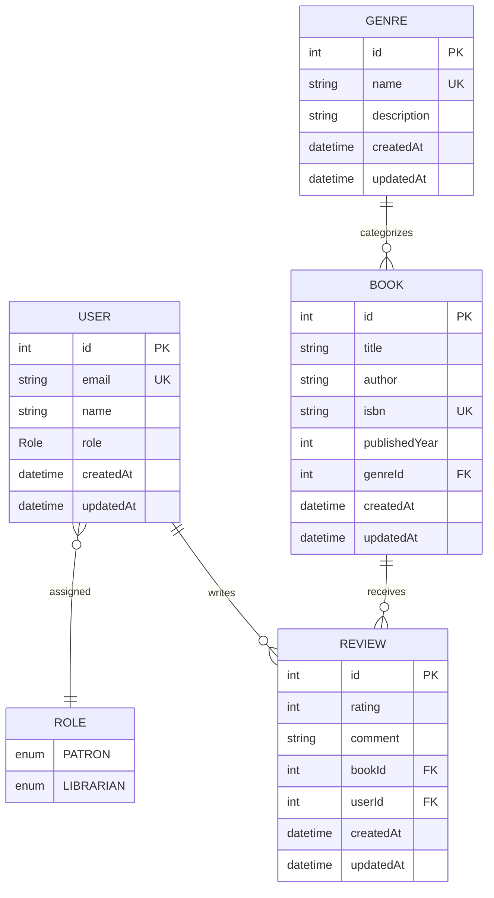

# Library Management System - Data Layer & Book Catalog

A robust, type-safe data access layer for a library management system built with **TypeScript**, **NestJS**, **Prisma ORM**, and **PostgreSQL**.

---

## 📚 Project Overview

This repository contains the foundational data layer designed for cataloging books, categorizing genres, managing patron and librarian accounts, and tracking book reviews. The implementation strictly models relational data integrity using Prisma ORM with PostgreSQL as the underlying relational database management system.

---

## 🗂️ Required Assignment Files

The core project files checked for this assignment:

| File Path | Description & Contents |
| :--- | :--- |
| [`api/prisma/schema.prisma`](file:///c:/Users/betel/Music/plp/library-management-system/api/prisma/schema.prisma) | Defines the `Role` enum (`PATRON`, `LIBRARIAN`), `User` model, `Genre` model, `Book` model (with `genreId` foreign key and `@relation`), and `Review` model (stretch task). |
| [`api/prisma/seed.ts`](file:///c:/Users/betel/Music/plp/library-management-system/api/prisma/seed.ts) | Idempotent seed script inserting 5 genres, 20 books distributed across those genres, 4 users with roles, and book reviews. |
| [`api/src/prisma/prisma.service.ts`](file:///c:/Users/betel/Music/plp/library-management-system/api/src/prisma/prisma.service.ts) | NestJS database service extending `PrismaClient`, implementing `OnModuleInit`, and invoking `await this.$connect()` on startup. |
| [`api/.env.example`](file:///c:/Users/betel/Music/plp/library-management-system/api/.env.example) | Safe template showing the `DATABASE_URL` placeholder format without exposing real credentials. |
| [`README.md`](file:///c:/Users/betel/Music/plp/library-management-system/README.md) | Architectural documentation, migration guide, schema rationale, and comparison notes. |

---

## 📐 Data Architecture & Entity Relationships



---

## 🧠 Schema Decisions

### Why Book References Genre Rather Than Embedding It

In relational data modeling, a fundamental design decision is whether an entity's category should be embedded directly (e.g., as a free-text string or JSON object on the `Book` record) or isolated into its own dedicated relation (`Genre`) referenced via a foreign key (`genreId`).

For our library management system, **`Book` references `Genre` through a normalized one-to-many relation** for several compelling architectural and operational reasons:

1. **Relational Normalization & Single Source of Truth (SSOT)**:
   - Genres are shared entities that classify dozens or hundreds of books simultaneously.
   - If genre data (such as the genre name and descriptive taxonomy) were embedded in every book row, updating a genre's name (for example, renaming `"Sci-Fi"` to `"Science Fiction & Speculative Fiction"`) would require mutating thousands of individual book records across the entire database.
   - Normalizing `Genre` into its own table ensures that genre metadata has a single source of truth; changing it requires updating a single record without any update anomalies or risk of data drift.

2. **Data Consistency & Input Validation**:
   - Storing genres as free text or unstructured embedded objects leaves room for inconsistencies, spelling errors, and duplicates (e.g., `"Sci-Fi"`, `"Science-Fiction"`, `"sci fi"`, and `"Science Fiction"`).
   - A dedicated `Genre` table with a `@unique` constraint on the `name` column guarantees uniform categorizations across all cataloged inventory.
   - The foreign key constraint (`genreId Int` with `@relation(fields: [genreId], references: [id])`) enforces referential integrity: no book can point to a non-existent genre at the database engine level.

3. **Query Performance and Indexed Filtering**:
   - In relational engines like PostgreSQL, foreign key integer columns (`genreId`) can be indexed with B-tree indices.
   - Queries filtering catalog searches by category (e.g., `SELECT * FROM "Book" WHERE "genreId" = 2`) or generating aggregation metrics (e.g., counting available books per genre) execute with maximum efficiency using fast indexed joins, rather than requiring expensive full-table text scans.

4. **Taxonomic Extensibility & Metadata Enrichment**:
   - A distinct `Genre` entity allows future enhancements without schema disruptions to the `Book` catalog. For instance, the library can easily add fields such as:
     - `slug` for clean catalog routing,
     - `aisleLocation` / `floor` for physical library navigation,
     - `ageRestriction` or `targetAudience` policies,
     - Hierarchical self-referencing relations (e.g., `parentGenreId` for sub-genres).
   - In an embedded setup, adding these attributes would severely bloat every book row with redundant duplicate data.

5. **Entity Lifecycle Independence**:
   - A genre exists as a conceptual classification regardless of whether the library currently has physical books on the shelf for that category.
   - If all books within a given genre are temporarily uncataloged or archived, an embedded genre would be wiped out from the system. A referenced entity preserves the genre classification independently of book inventory.

---

## 🔄 Stretch Reflection: Modeling in Prisma vs. a Document Database

When modeling this catalog in **Prisma (Relational / PostgreSQL)** versus a **Document Database (e.g., MongoDB)**, the most striking difference is **upfront schema strictness and referential integrity versus runtime flexibility and query-driven denormalization**:

* **Declarative Relations vs. Loose References**:
  In a document database like MongoDB, relationships are typically modeled either by embedding subdocuments or by storing loose `ObjectId` references. However, MongoDB does not enforce referential integrity at the database engine layer. If a document references an ID that is later deleted, you end up with orphaned references unless complex application-level hooks or two-phase cascades are manually engineered. In contrast, Prisma allows declaring explicit relation attributes (`@relation(fields: [genreId], references: [id], onDelete: Cascade)`). The PostgreSQL database engine guarantees that foreign keys are valid at all times.

* **Type-Safe Navigation vs. Dynamic Access**:
  With Prisma, relations are codified in the declarative schema (`schema.prisma`). Running `prisma generate` produces strongly-typed TypeScript clients. When querying a book and its genre (`prisma.book.findMany({ include: { genre: true, reviews: true } })`), TypeScript autocomplete automatically infers the exact return payload structure, preventing runtime errors. In document databases, querying across collections requires `$lookup` aggregation pipelines that return untyped BSON documents requiring manual TypeScript interface casting.

* **Predictable Evolution via Versioned Migrations**:
  Prisma pairs schema definitions with versioned SQL migrations (`prisma/migrations`), providing a deterministic, auditable history of database DDL changes across local development, staging, and hosted production databases. In document stores, migrations are typically implicit or handled through ad-hoc migration scripts that mutate documents in-flight.

---

## 🛠️ Setup & Migration Guide

### 1. Prerequisites
- **Node.js** (v18.x or v20.x+ recommended)
- **npm** or **pnpm**
- A **PostgreSQL** database (e.g., hosted on [Neon](https://neon.tech/), [Supabase](https://supabase.com/), [Render](https://render.com/), or local PostgreSQL)

### 2. Environment Configuration
Navigate to the `api` directory:
```bash
cd api
```

Copy the example environment configuration:
```bash
cp .env.example .env
```

Open `.env` and configure your valid PostgreSQL connection string:
```env
DATABASE_URL="postgresql://<user>:<password>@<host>:<port>/<database>?schema=public"
```

### 3. Install Dependencies
```bash
npm install
```

### 4. Generate Prisma Client
Generate the Prisma Client types:
```bash
npx prisma generate
```

### 5. Run Database Migrations
Apply the migrations to your hosted PostgreSQL database:
```bash
npx prisma migrate dev --name init
```
*(Or in production/CI environments: `npx prisma migrate deploy`)*

### 6. Seed the Database
Populate the database with the predefined genres, 20 cataloged books, users, and reviews:
```bash
npx prisma db seed
```
*(Alternatively: `npm run prisma:seed`)*

### 7. Explore Data in Prisma Studio
To inspect the catalog interactively in a visual dashboard:
```bash
npx prisma studio
```
