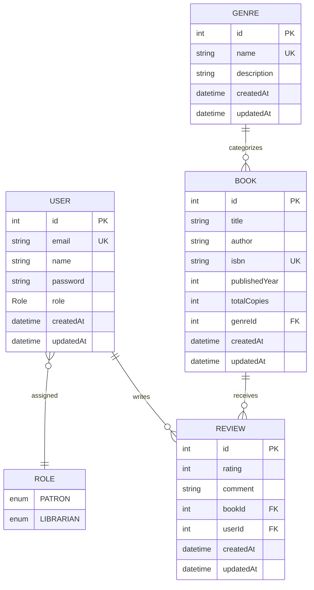

# Library Management System - Data Layer, Auth & Catalog API

A robust, type-safe RESTful API and relational data access layer for a library management system built with **TypeScript**, **NestJS**, **Prisma ORM**, and **PostgreSQL**.

---

## 📚 Project Overview

This repository contains the complete backend core for a library management system:
- **Relational Data Model & Migrations**: Modeled with Prisma ORM on PostgreSQL with strict referential integrity.
- **Authentication & RBAC**: Secure JWT-based authentication with bcrypt password hashing, `@Roles()` decorator, and `RolesGuard` enforcing librarian-only permissions for catalog management.
- **Rate-Limiting**: Login protection using `@nestjs/throttler`.
- **Genre Management**: Full CRUD (`create`, `findAll`, `findOne`, `update`, `remove`) with validation.
- **Book Catalog**: Filtering by `genreId`, case-insensitive search by `title` and `author`, and `skip`/`take` pagination on `GET /books`. Guarded mutations (`POST`, `PATCH`, `DELETE`) restricted to `LIBRARIAN` accounts.
- **User Profile**: Authenticated `@Req()` user profile retrieval (`GET /users/profile`).
- **API Testing**: Comprehensive Postman collection exported to `docs/postman_collection.json`.

---

## 🗂️ Assignment Verification Checklist

The files verified for this assignment and their key implementations:

| File Path | Requirements & Implementation |
| :--- | :--- |
| [`api/src/genres/genres.controller.ts`](file:///c:/Users/betel/Music/plp/library-management-system/api/src/genres/genres.controller.ts)<br>[`api/src/genres/genres.service.ts`](file:///c:/Users/betel/Music/plp/library-management-system/api/src/genres/genres.service.ts)<br>[`api/src/genres/genres.module.ts`](file:///c:/Users/betel/Music/plp/library-management-system/api/src/genres/genres.module.ts) | Full CRUD (`create`, `findAll`, `findOne`, `update`, `remove`) for Genre with DTO validation and conflict checks. |
| [`api/src/books/dto/create-book.dto.ts`](file:///c:/Users/betel/Music/plp/library-management-system/api/src/books/dto/create-book.dto.ts) | `class-validator` decorators on every single field: `title`, `author`, `isbn`, `totalCopies`, `genreId`. |
| [`api/src/books/books.controller.ts`](file:///c:/Users/betel/Music/plp/library-management-system/api/src/books/books.controller.ts) | `GET /books` reads `genreId`, `search`, `page`, and `limit` from `@Query()`; `POST`, `PATCH`, `DELETE` are guarded with `JwtAuthGuard` and `RolesGuard`. |
| [`api/src/books/books.service.ts`](file:///c:/Users/betel/Music/plp/library-management-system/api/src/books/books.service.ts) | `findAll()` builds a Prisma `where` clause from `genreId` and `search` (title/author) and applies `skip`/`take` for pagination. |
| [`api/src/auth/auth.controller.ts`](file:///c:/Users/betel/Music/plp/library-management-system/api/src/auth/auth.controller.ts)<br>[`api/src/auth/auth.service.ts`](file:///c:/Users/betel/Music/plp/library-management-system/api/src/auth/auth.service.ts)<br>[`api/src/auth/auth.module.ts`](file:///c:/Users/betel/Music/plp/library-management-system/api/src/auth/auth.module.ts) | `POST /auth/register` and `POST /auth/login` endpoints; passwords hashed with `bcrypt` (10 salt rounds); issues signed JWT tokens; rate-limited login. |
| [`api/src/auth/jwt.strategy.ts`](file:///c:/Users/betel/Music/plp/library-management-system/api/src/auth/jwt.strategy.ts)<br>[`api/src/auth/jwt-auth.guard.ts`](file:///c:/Users/betel/Music/plp/library-management-system/api/src/auth/jwt-auth.guard.ts) | `JwtStrategy` verifies Bearer tokens using `JWT_SECRET`; `JwtAuthGuard` extends `AuthGuard('jwt')`. |
| [`api/src/auth/roles.decorator.ts`](file:///c:/Users/betel/Music/plp/library-management-system/api/src/auth/roles.decorator.ts)<br>[`api/src/auth/roles.guard.ts`](file:///c:/Users/betel/Music/plp/library-management-system/api/src/auth/roles.guard.ts) | `@Roles()` decorator + `RolesGuard` inspecting `req.user.role` against required roles. |
| [`api/src/main.ts`](file:///c:/Users/betel/Music/plp/library-management-system/api/src/main.ts) | Configures `app.useGlobalPipes(new ValidationPipe({ whitelist: true }))` and `app.enableCors()`. |
| [`docs/postman_collection.json`](file:///c:/Users/betel/Music/plp/library-management-system/docs/postman_collection.json) | Complete Postman collection containing requests for all Auth, Profile, Genres, and Books endpoints. |
| [`api/prisma/schema.prisma`](file:///c:/Users/betel/Music/plp/library-management-system/api/prisma/schema.prisma) | Defines `Role` enum (`PATRON`, `LIBRARIAN`), `User` model, `Genre` model, `Book` model (with `genreId` foreign key and `@relation`), and `Review` model. |
| [`api/prisma/seed.ts`](file:///c:/Users/betel/Music/plp/library-management-system/api/prisma/seed.ts) | Inserts 5 genres, 20 books across genres, users with bcrypt hashed passwords, and book reviews. |
| [`api/src/prisma/prisma.service.ts`](file:///c:/Users/betel/Music/plp/library-management-system/api/src/prisma/prisma.service.ts) | Extends `PrismaClient`, implements `OnModuleInit`, and calls `await this.$connect()` in `onModuleInit()`. |
| [`api/.env.example`](file:///c:/Users/betel/Music/plp/library-management-system/api/.env.example) | Safe environment template with `DATABASE_URL`, `JWT_SECRET`, and `PORT`. |

---

## 📐 Data Architecture & Entity Relationships



---

## 🧠 Schema Decisions

### Why Book References Genre Rather Than Embedding It

In relational data modeling, a fundamental design decision is whether an entity's category should be embedded directly (e.g., as a free-text string or JSON object on the `Book` record) or isolated into its own dedicated relation (`Genre`) referenced via a foreign key (`genreId`).

For our library management system, **`Book` references `Genre` through a normalized one-to-many relation** for several compelling architectural and operational reasons:

1. **Relational Normalization & Single Source of Truth (SSOT)**:
   - Genres are shared entities that classify dozens or hundreds of books simultaneously.
   - If genre data (such as the genre name and descriptive taxonomy) were embedded in every book row, updating a genre's name (for example, renaming `"Sci-Fi"` to `"Science Fiction & Speculative Fiction"`) would require mutating thousands of individual book records across the entire database.
   - Normalizing `Genre` into its own table ensures that genre metadata has a single source of truth; changing it requires updating a single record without any update anomalies or risk of data drift.

2. **Data Consistency & Input Validation**:
   - Storing genres as free text or unstructured embedded objects leaves room for inconsistencies, spelling errors, and duplicates (e.g., `"Sci-Fi"`, `"Science-Fiction"`, `"sci fi"`, and `"Science Fiction"`).
   - A dedicated `Genre` table with a `@unique` constraint on the `name` column guarantees uniform categorizations across all cataloged inventory.
   - The foreign key constraint (`genreId Int` with `@relation(fields: [genreId], references: [id])`) enforces referential integrity: no book can point to a non-existent genre at the database engine level.

3. **Query Performance and Indexed Filtering**:
   - In relational engines like PostgreSQL, foreign key integer columns (`genreId`) can be indexed with B-tree indices.
   - Queries filtering catalog searches by category (e.g., `SELECT * FROM "Book" WHERE "genreId" = 2`) or generating aggregation metrics (e.g., counting available books per genre) execute with maximum efficiency using fast indexed joins, rather than requiring expensive full-table text scans.

4. **Taxonomic Extensibility & Metadata Enrichment**:
   - A distinct `Genre` entity allows future enhancements without schema disruptions to the `Book` catalog. For instance, the library can easily add fields such as:
     - `slug` for clean catalog routing,
     - `aisleLocation` / `floor` for physical library navigation,
     - `ageRestriction` or `targetAudience` policies,
     - Hierarchical self-referencing relations (e.g., `parentGenreId` for sub-genres).
   - In an embedded setup, adding these attributes would severely bloat every book row with redundant duplicate data.

5. **Entity Lifecycle Independence**:
   - A genre exists as a conceptual classification regardless of whether the library currently has physical books on the shelf for that category.
   - If all books within a given genre are temporarily uncataloged or archived, an embedded genre would be wiped out from the system. A referenced entity preserves the genre classification independently of book inventory.

---

## 🔄 Stretch Reflection: Modeling in Prisma vs. a Document Database

When modeling this catalog in **Prisma (Relational / PostgreSQL)** versus a **Document Database (e.g., MongoDB)**, the most striking difference is **upfront schema strictness and referential integrity versus runtime flexibility and query-driven denormalization**:

* **Declarative Relations vs. Loose References**:
  In a document database like MongoDB, relationships are typically modeled either by embedding subdocuments or by storing loose `ObjectId` references. However, MongoDB does not enforce referential integrity at the database engine layer. If a document references an ID that is later deleted, you end up with orphaned references unless complex application-level hooks or two-phase cascades are manually engineered. In contrast, Prisma allows declaring explicit relation attributes (`@relation(fields: [genreId], references: [id], onDelete: Cascade)`). The PostgreSQL database engine guarantees that foreign keys are valid at all times.

* **Type-Safe Navigation vs. Dynamic Access**:
  With Prisma, relations are codified in the declarative schema (`schema.prisma`). Running `prisma generate` produces strongly-typed TypeScript clients. When querying a book and its genre (`prisma.book.findMany({ include: { genre: true, reviews: true } })`), TypeScript autocomplete automatically infers the exact return payload structure, preventing runtime errors. In document databases, querying across collections requires `$lookup` aggregation pipelines that return untyped BSON documents requiring manual TypeScript interface casting.

* **Predictable Evolution via Versioned Migrations**:
  Prisma pairs schema definitions with versioned SQL migrations (`api/prisma/migrations`), providing a deterministic, auditable history of database DDL changes across local development, staging, and hosted production databases. In document stores, migrations are typically implicit or handled through ad-hoc migration scripts that mutate documents in-flight.

---

## 🚀 API Endpoint Reference

### Authentication
- `POST /auth/register`: Register a new user (`email`, `name`, `password`, `role`). Password is encrypted using `bcrypt`.
- `POST /auth/login`: Authenticate user and receive a JWT. Protected by `@nestjs/throttler` (max 5 attempts per minute).

### Users (Stretch)
- `GET /users/profile`: Protected by `JwtAuthGuard`. Reads `req.user` injected by `JwtStrategy`.

### Genres (Full CRUD)
- `POST /genres`: Create a genre (`CreateGenreDto` with `@IsString() @IsNotEmpty() name`).
- `GET /genres`: List all genres with book count aggregations.
- `GET /genres/:id`: Get a specific genre with its cataloged books.
- `PATCH /genres/:id`: Update genre details.
- `DELETE /genres/:id`: Delete a genre.

### Books
- `GET /books`: Public search & filter:
  - Query parameters: `genreId`, `search` (case-insensitive substring in title or author), `page` (default: 1), `limit` (default: 10).
- `GET /books/:id`: Public single book retrieval with genre and reviews.
- `POST /books`: **Guarded** with `JwtAuthGuard` + `RolesGuard(@Roles(Role.LIBRARIAN))`. Validated with `CreateBookDto`.
- `PATCH /books/:id`: **Guarded** (LIBRARIAN only). Update book details.
- `DELETE /books/:id`: **Guarded** (LIBRARIAN only). Delete a book from catalog.

---

## 🛠️ Setup & Running

### 1. Prerequisites
- **Node.js** (v18.x or v20.x+)
- **PostgreSQL** (local or hosted, e.g. Neon, Supabase, Railway)

### 2. Environment Configuration
Copy the template and set your connection strings:
```bash
cp api/.env.example api/.env
```

### 3. Install Dependencies
Dependencies are installed in the workspace root:
```bash
npm install
```

### 4. Database Setup & Seeding
```bash
# Generate Prisma Client
npm run prisma:generate

# Apply migrations
npm run prisma:deploy

# Seed the database (genres, books, users, reviews)
npm run prisma:seed
```

### 5. Start the Application
```bash
# Development mode
npm run start:dev

# Production build
npm run build
node dist/api/src/main.js
```

### 6. Testing with Postman
Import the collection located at:
```
docs/postman_collection.json
```
Into Postman, set the `baseUrl` variable (default: `http://localhost:3000`), authenticate via `POST /auth/login`, and set the `token` and `librarianToken` variables to test all endpoints.
